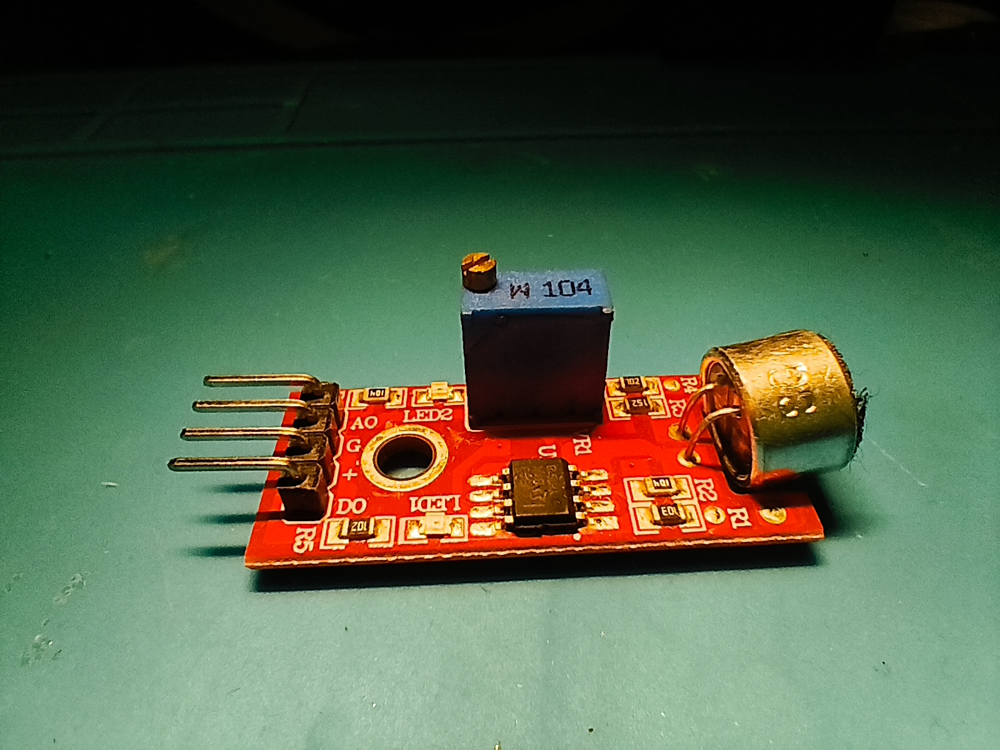
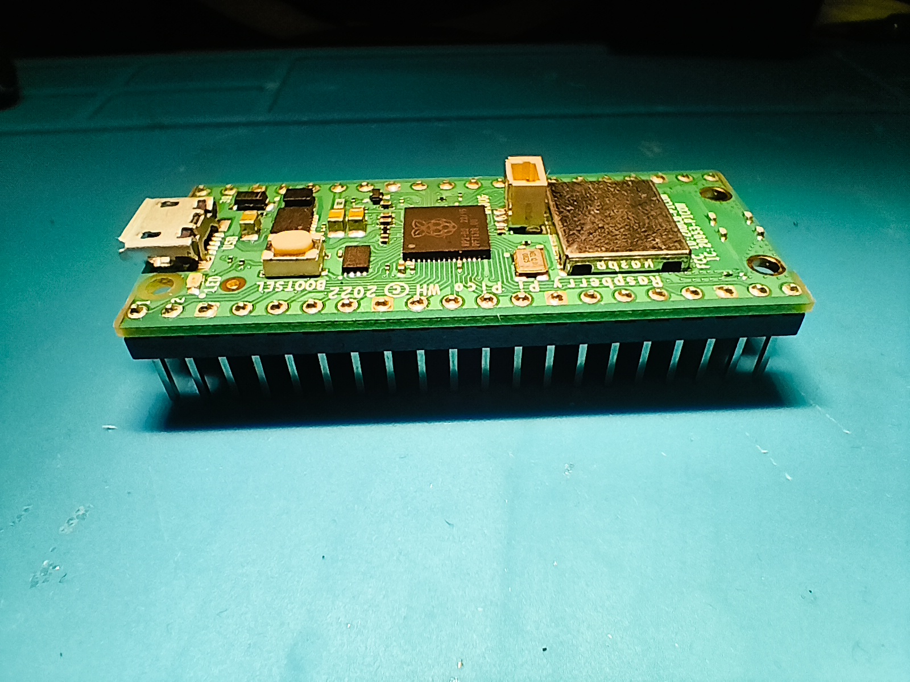
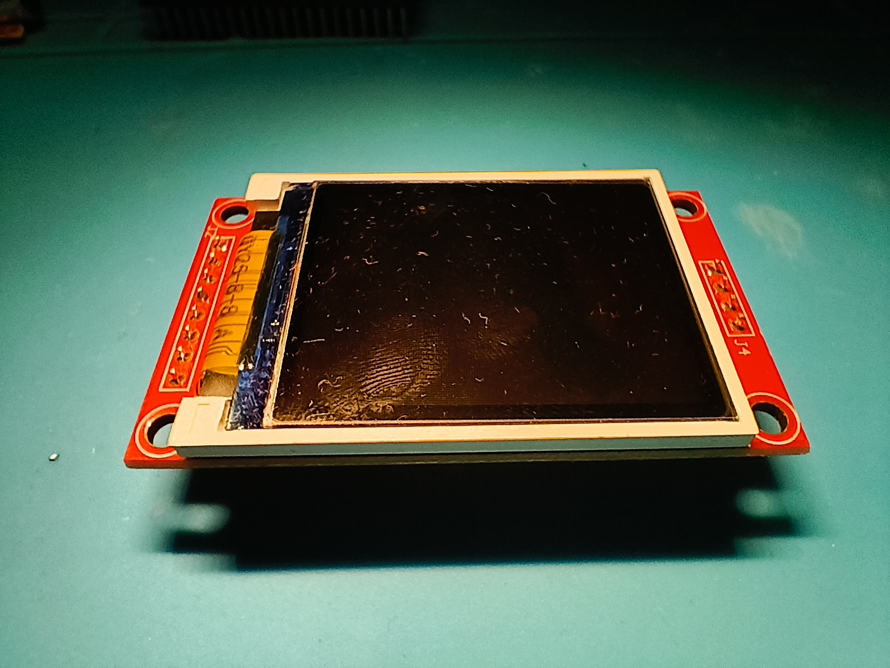

## 2026-10-16: Making the PCB
Today I first looked at the components I wanted to use and I decided I will use my microphone breakout board that I got in an arduino starter kit for christmas a few years ago.  I also decided I would use a Raspberry Pi pico as the microcontroller which I got from sprig.hackclub.com about half a year ago.  It also had a 1.8 inch TFT display which I will also use. 

When I knew all of this I started making the schematic for the PCB in KiCad and I soon found out it was really hard to get a symbol/footprint for the TFT display. To solve this I downloaded the repository of SPRIG and I used their footprint (Shout out to HackClub for making everything open source).  For the Microphone breakout board I just used a 1x4 connector.  As it uses 5v instead of the 3.3v the pico provides I decided I will use a 5v regulator board I had laying around. For this I just used a standard 1x3 connector. 

So I had drawn up the schematic, routed the PCB and when I ran the DRC it spit out 9 errors. One of which was that I forgot to add edges, this was a quick and easy fix. The others were about some pins being too close. Turns out the footprint I chose for the microphone and voltage regulator were designed in a way that the pins were almost touching. This wasn't a huge deal as I got to learn how to use the footprint editor and I fixed the footprints myself.

In the 2 hours that I spent on this I now have a schematic and a PCB. 
I still need to make the BOM, Upload more pictures, update the readme and make a full BOM. I also need to make the software, I think that will be the biggest challenge but I'm sure I will figure it out. 
